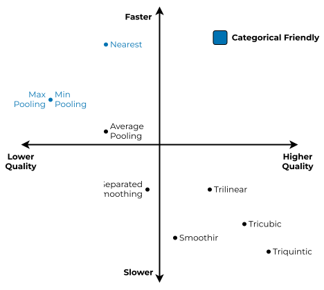
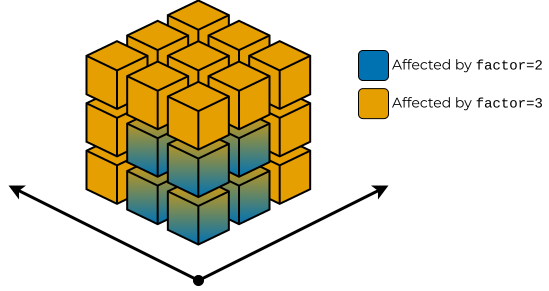
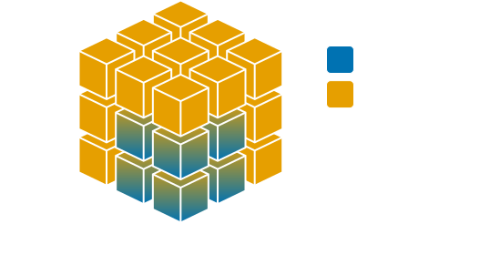

How to Choose and Configure a Downsampling Strategy
===================================================

One of the main reasons to create volsegtools was to provide the option to
switch downsampling methods, because different kinds of data and use cases
need different approaches to the sampling.

Current list of builtin methods can be found in :doc:`/api/downsampling`.

When you are choosing the particular strategy, the most important question that
you have to ask yourselves is: **"What type of data do I want to downsample?"**
Because some methods are not usable for some kinds of data by definition. For
example, given that you have a dataset containing binary mask (i.e. categorical
data), you simply cannot use any interpolation or smoothing methods, because
you would destroy the data.

Another question that you have to ask yourselves is: **"How fast do I want to do
the downsampling?"** or the same question but from the different standpoint:
**"How high has to be the quality of downsampled data"** Because, generally
speaking, methods yielding higher quality data are usually slower.

After you have answered these questions you can use this matrix to decide
which method would you like to use:

   Choice matrix for downsampling strategy.

   Choice matrix for downsampling strategy.

This matrix was create from our experience and personal feelings about the
results. It is worth a while to check different methods for your data and to
measure the error rate (more about this can be found in
:doc:`/how-to/error-evaluation`).

Choosing the Right Factor
-------------------------

Some methods have optional parameter called factor (or zoom) that affects how
big neigborhood is affected while generating new level of resolution.
Effectively, the higher the factor (or lower the zoom) the bigger neigborhood
is collapsed into a single value. Thus it might be faster, but with lower
quality. This might come in handy for really huge datasets.

The effect of higher factor can be seed in the figure below.

   Visualization of ``factor`` effect range.

   Visualization of ``factor`` effect range.

The choice of correct downsampling methods is more important when choosing
bigger factor (or smaller zoom). Good example would be methods based on
interpolation, as higher the order of interpolation the bigger the neighborhood
is considered. Thus lowering the overall error.

.. note::
   Some methods might use ``zoom`` rather than ``factor``, in that case ``zoom = 1 / factor``.

Below is an example of setting the ``zoom = 1/3`` for
:class:`~volsegtools.TrilinearInterpolation` and
:class:`~volsegtools.TriquinticInterpolation` strategies.

.. grid:: 2

   .. grid-item::

      .. figure:: ../_static/emd_53130_t1_zoom_033.png
         :width: 100%

         Original Resolution (160MB)

   .. grid-item::

      .. figure:: ../_static/emd_53130_t5_zoom_033.png
         :width: 100%

         First level of downsampling (20MB)

