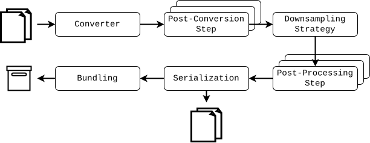
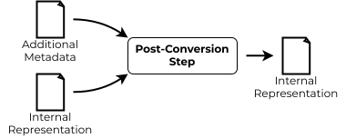
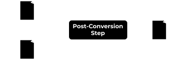

Pipeline
********

The whole library is based on the pipeline architecture where each stage
has defined interface. Therefore, it is possible to swap implementation of each
stage for a given use case.

   Architecture of ``volsegtools`` pipeline

   Architecture of ``volsegtools`` pipeline

So, there are individual stages with different interface and use-case. Each is
introduced below:

Pipeline Stages
===============

Converter
---------

The purpose of the *Converter* is to take some supported format and transform
it into an internal representation that is known to the rest of the stages.

Ideally, after this stage the dataset should be complete. However, it might
happen that something is missing due to the design of the input format, this
can be sorted out by the next stage.

   Converter stage.

   Converter stage.

The interface for the converter is :class:`~volsegtools.abc.Converter`.

Post-Conversion Step
--------------------

Sometimes, there could be some format (or some internal organization's policy)
where the metadata is supplied by a separate file. For this reason we have
included the *Post-Conversion Step* in the pipeline.

You might define an arbitrary functionality in this stage.

**It is expected that after this stage the input dataset is complete**.

   Post-Conversion step stage.

   Post-Conversion step stage.

The interface for the post-conversion is :class:`~volsegtools.abc.PostConversionStep`.

Downsampling Step
-----------------

In this stage the pipeline is creating the multi-resolution hierarchy pyramid.
The process is hardcoded into the pipeline and the user can change method that
used for the downsampling (based on the `Strategy design pattern <https://refactoring.guru/design-patterns/strategy>`__).

The number of resolution levels can be set using the TODO.

   Downsampling step with downsampling strategy.

   Downsampling step with downsampling strategy.

The interface for the downsampling strategy is :class:`~volsegtools.abc.DownsamplingStrategy`.

Post-Processing Step
--------------------

   Post-Processing step stage.

   Post-Processing step stage.

Serializer
----------

   Serializer stage.

   Serializer stage.

For each kind of data that might be represented by the internal representation
has to be set a single serializer. That means that if your particular pipeline
is not supposed to work with some kind of data (e.g. segmentation meshes) you
**do not** have to set serializer for that.

.. code-block:: python

   # setting BinaryCIF serializer for each data kind.
   builder = vst.create_builder()
   (
       builder.set_serializer(vst.DataKind.VOLUME, vst.BCIFSerializer())
       builder.set_serializer(vst.DataKind.SEGMENTATION_VOLUME, vst.BCIFSerializer())
       builder.set_serializer(vst.DataKind.SEGMENTATION_MESH, vst.BCIFSerializer())
       builder.set_serializer(vst.DataKind.SEGMENTATION_MASK, vst.BCIFSerializer())
   )
   pipeline = builder.build()

Bundler
-------

   Bundler stage.

   Bundler stage.

Building Pipelines
==================

Construction of pipelines can be done manually, but that is not really
ergonomic. For that reason we provide construction via the Builder Pattern.

Each configurable part of the pipeline can be manually swapped using the
pipeline builder class. Finally, the pipeline can be constructed and validated
using this builder.

Some separation text.

.. code-block:: python

   builder = vst.create_builder()
   (
       builder.set_converter(vst.MRCConverter())
   )
   pipeline = builder.build()
